<div align="center">

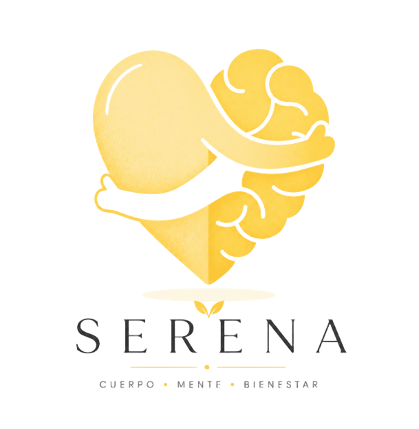

# Serena

### Bienestar emocional y gestión académica en una sola plataforma para toda la institución educativa

*Cuerpo · Mente · Bienestar*

[](https://serena.infinityfreeapp.com/)
[](docs/Presentacion_Serena_SENA_final.pptx)
[](docs/INSTALACION.md)


<br>

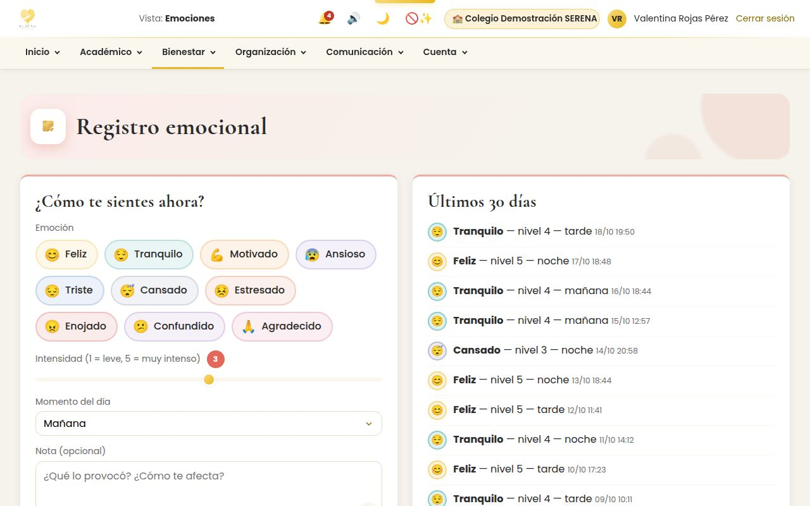

</div>

---

## Tabla de contenido

1. [El problema](#-el-problema)
2. [La solución](#-la-solución)
3. [Serena en números](#-serena-en-números)
4. [Capturas](#-capturas)
5. [Qué incluye](#-qué-incluye)
6. [Del registro al acompañamiento](#-del-registro-al-acompañamiento)
7. [Los 11 roles y quién ve qué](#-los-11-roles-y-quién-ve-qué)
8. [Seguridad y privacidad](#-seguridad-y-privacidad)
9. [Experiencia y accesibilidad](#-experiencia-y-accesibilidad)
10. [Arquitectura](#-arquitectura)
11. [Tecnología y decisiones](#-tecnología-y-decisiones)
12. [Estructura del repositorio](#-estructura-del-repositorio)
13. [Instalación rápida](#-instalación-rápida)
14. [Modo demostración](#-modo-demostración)
15. [Documentación](#-documentación)
16. [Hoja de ruta](#-hoja-de-ruta)
17. [Equipo](#-equipo)

---

## 🧩 El problema

Estrés, ansiedad, falta de motivación y desorganización afectan a muchos jóvenes. Muchas veces el colegio se entera **tarde**: las señales (varios días de ánimo bajo, poco sueño, dejar de entrar a clase) existen, pero están dispersas y nadie las junta.

Las herramientas que existen resuelven **una sola parte**:

| Tipo | Ejemplos | Qué les falta |
|---|---|---|
| Apps de bienestar | Daylio, Habitica, Reflectly | Son individuales: nadie en el colegio puede acompañar, y no tienen nada académico. |
| Plataformas académicas | Master2000, Sinaí, Phidias, Q10 | Gestionan notas y matrícula, pero no el bienestar emocional ni las alertas tempranas. |

## 💡 La solución

**Serena reúne las dos cosas y conecta al estudiante con psicología y orientación a tiempo.**

- El **estudiante** registra cómo se siente, cómo duerme y sus hábitos, y consulta sus notas, asistencia y horario.
- **Psicología y orientación** reciben **alertas tempranas** y acompañan por chat, citas y encuestas.
- **Docentes y secretaría académica** gestionan matrícula, notas, asistencia, horarios, boletines y certificados.
- **Familias, directivos y la Secretaría de Educación** ven lo que les corresponde, ni más ni menos.

Funciona para **varios colegios a la vez**, desde **grado sexto**, en celular, tablet y computador, y no le cuesta nada a la institución.

---

## 📊 Serena en números

<div align="center">

| 11 | 110 | 69 | 125 | 4 | $0 |
|:---:|:---:|:---:|:---:|:---:|:---:|
| roles, cada uno con su panel | tablas en la base de datos | informes en PDF y CSV | capturas en el manual de ayuda | métodos de verificación en 2 pasos | costo para la institución |

</div>

---

## 📸 Capturas

<table>
<tr>
<td width="50%">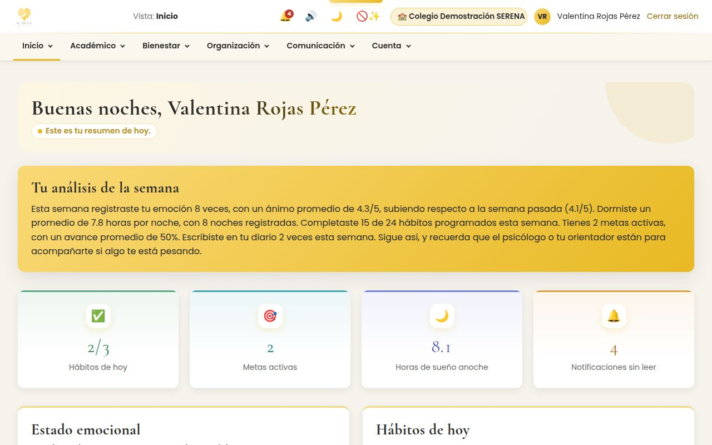<br><sub><b>Inicio del estudiante:</b> análisis de la semana, hábitos, metas y sueño.</sub></td>
<td width="50%">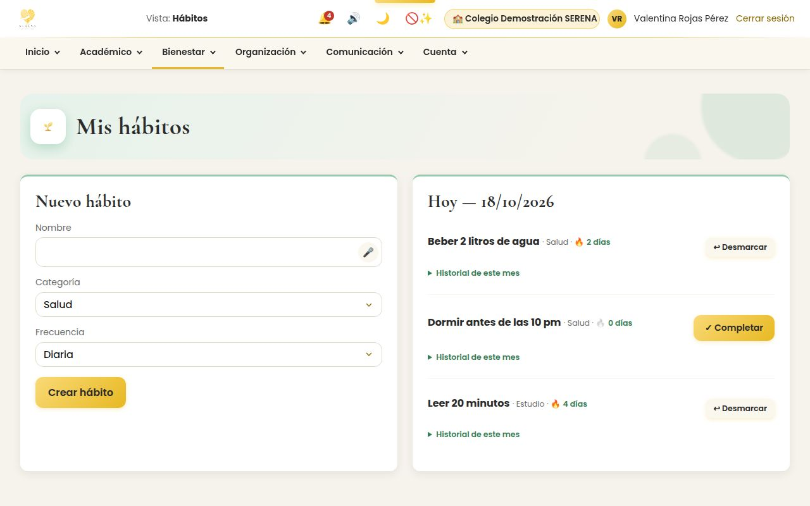<br><sub><b>Hábitos:</b> rachas que se celebran con confeti y sonido.</sub></td>
</tr>
<tr>
<td>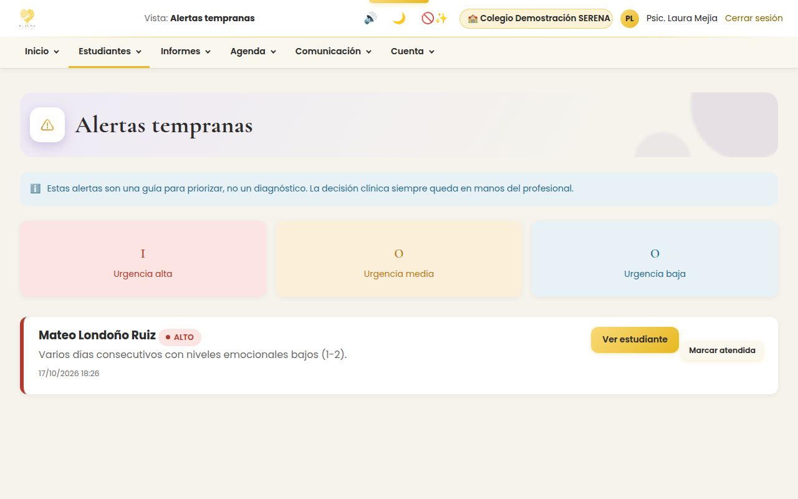<br><sub><b>Alertas tempranas:</b> psicología ve a quién buscar primero.</sub></td>
<td>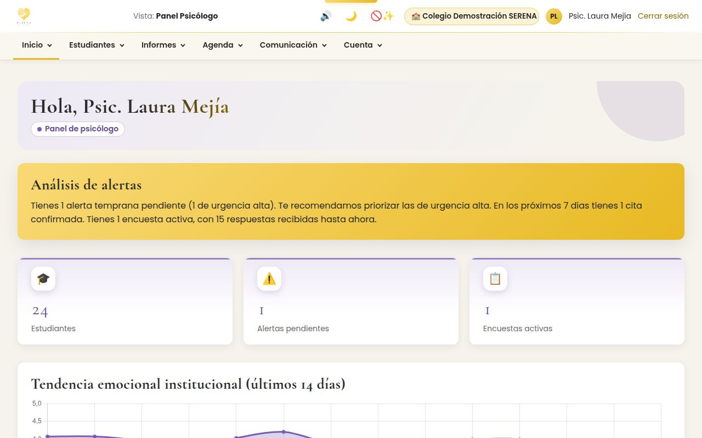<br><sub><b>Panel de psicología:</b> tendencia emocional institucional.</sub></td>
</tr>
<tr>
<td>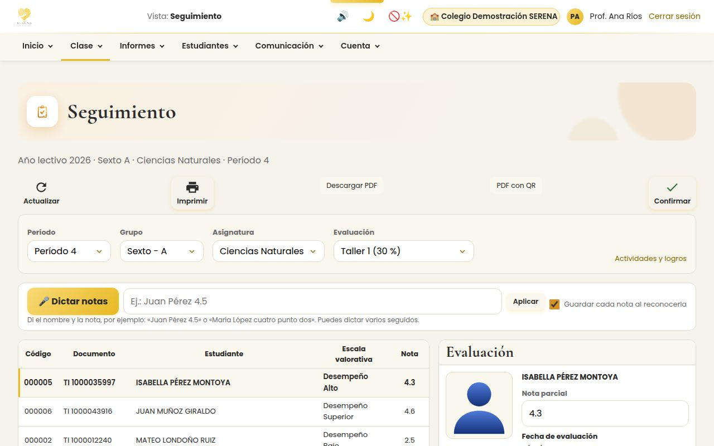<br><sub><b>Planilla del docente:</b> notas por período, grupo y asignatura, con dictado por voz.</sub></td>
<td>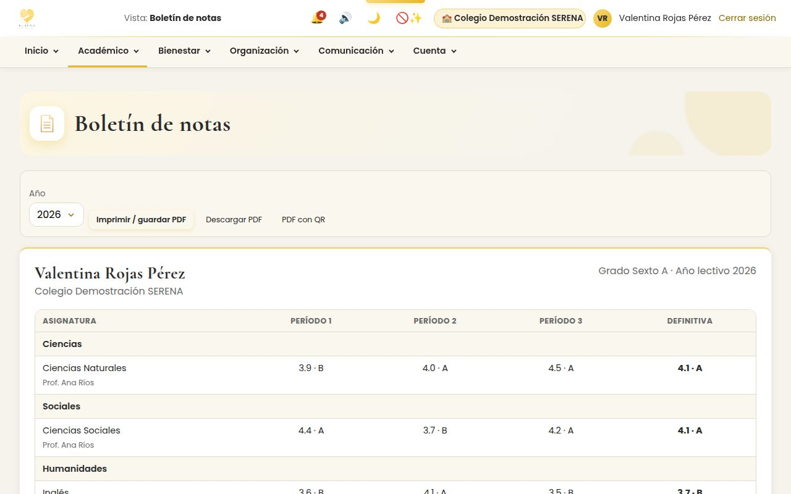<br><sub><b>Boletín:</b> lo que ven estudiantes y familias.</sub></td>
</tr>
<tr>
<td>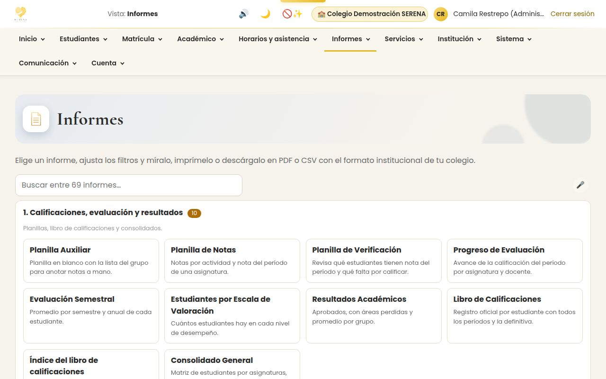<br><sub><b>69 informes</b> con formato institucional.</sub></td>
<td>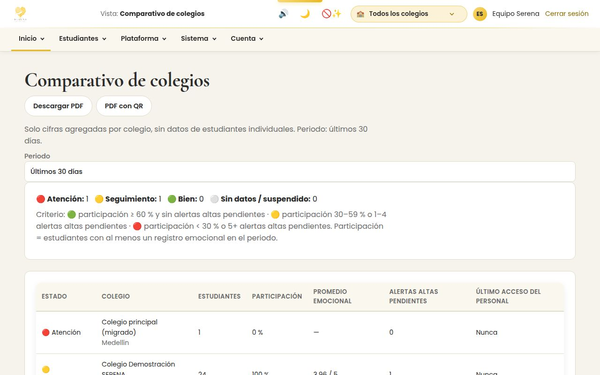<br><sub><b>Secretaría de Educación:</b> comparativo de colegios, solo con cifras agregadas.</sub></td>
</tr>
</table>

> Todas las capturas usan el **colegio de demostración**, con datos ficticios.

---

## 🧰 Qué incluye

### 💛 Bienestar emocional

| Módulo | Qué hace |
|---|---|
| **Emociones** | Registro varias veces al día, con intensidad, momento y nota; cada emoción tiene su color. |
| **Sueño** | Horas y calidad, y su relación con el ánimo. |
| **Diario** | Texto, etiquetas e imágenes, protegido con PIN. Solo lo lee el estudiante. |
| **Hábitos y metas** | Rachas, subtareas, insignias y celebraciones. |
| **Estadísticas** | Mapa del ánimo, gráficos por período e informe en PDF. |
| **Alertas tempranas** | Por días seguidos de ánimo bajo, por inactividad o por el botón de ayuda urgente. |
| **Chat y citas** | Dos canales: emocional (psicología y orientación) y académico (docente de grupo). Agenda con disponibilidad real. |
| **Apoyo** | Encuestas, respiración guiada, recursos y líneas de ayuda (Línea 106 y 123). |
| **Pulso de grupo** | Pregunta anónima del docente para sentir el clima del salón. |

### 📚 Gestión académica

| Módulo | Qué hace |
|---|---|
| **Inscripción y matrícula** | Formulario web para familias, revisión, matrícula, renovación y promoción de año. |
| **Evaluación** | Sistema institucional configurable: estructura de la planilla y escalas numéricas o descriptivas. |
| **Notas** | Planilla del docente con actividades y logros, dictado por voz y boletín por período. |
| **Asistencia** | Lista por clase, reporte y alerta de ausentismo. |
| **Horarios** | Franjas, grupos y docentes, con detección de cruces. |
| **Hoja de vida** | Datos, familia, salud, observador, convivencia (Ley 1620) y aula de apoyo (PIAR). |
| **Certificados** | Con código QR que cualquiera puede verificar en línea sin iniciar sesión. |
| **Informes** | 69 informes con logo, DANE, resolución y firmas, en PDF, CSV o impresión. |
| **SIMAT y SIMPADE** | Revisión, conciliación y exportación para los sistemas del Ministerio. |
| **Servicios** | Restaurante escolar y cartera (cargos y pagos). |

### 👨‍👩‍👧 Familias y comunidad

- **Cuentas de familia desde la hoja de vida:** al guardar a la madre, el padre o el acudiente se crea su cuenta. Si el acudiente es la misma persona que la madre o el padre, **no se duplica**.
- **Una persona, una cuenta:** una docente que también es madre entra con la misma cuenta y elige el rol. Si su documento está en **varios colegios**, elige la institución.
- **Comunicados** de la Secretaría de Educación a rectores y administradores.

### 🗺️ Plataforma

- **Varios colegios** aislados entre sí, con una capa de **Secretaría de Educación** (semáforo, comparativos, reportes, traslados y comunicados) y un **superadmin** de plataforma.
- **Asistente «Pregúntale a Serena»** y análisis de informes con IA (OpenRouter, modelos gratuitos). Es opcional, y los datos se anonimizan antes de enviarse.
- **Centro de ayuda** por rol, con buscador, temas frecuentes, asistente y manual descargable en PDF y HTML.

---

## 🔄 Del registro al acompañamiento

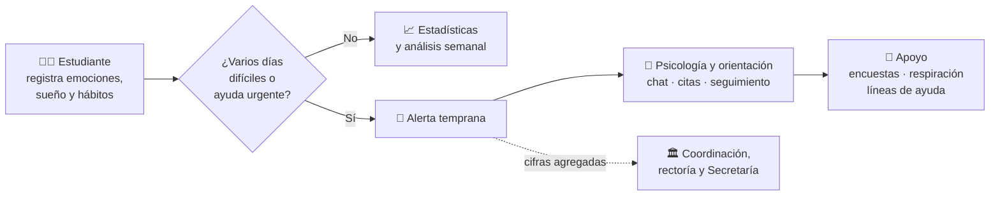

---

## 👥 Los 11 roles y quién ve qué

| Rol | Para qué sirve |
|---|---|
| `estudiante` | Registra su bienestar y consulta notas, asistencia y horario. |
| `acudiente` | Familia: boletines, asistencia, horario y hoja de vida de sus hijos. |
| `docente` | Toma lista, califica, planea y lanza el pulso de grupo. |
| `psicologo` | Atiende alertas, chatea, agenda citas y hace seguimientos. |
| `orientador` | Igual que psicología, solo con los grupos a su cargo. |
| `coordinador` | Convivencia, asistencia, horarios y reportes. |
| `rector` | Visión institucional. |
| `secretaria_academica` | Inscripciones, matrículas, boletines, certificados y SIMAT. |
| `administrador` | Usuarios, grupos, plan académico y configuración del colegio. |
| `secretaria` | Secretaría de Educación: varios colegios, solo cifras agregadas. |
| `superadmin` | Toda la plataforma: colegios, secretarías, respaldos y salud del sistema. |

**Privacidad por diseño:** cada persona ve solo lo que necesita para acompañar.

| Información | Estudiante | Familia | Docentes | Psicología y orientación | Coordinación y rectoría | Administración | Secretaría de Educación |
|---|:---:|:---:|:---:|:---:|:---:|:---:|:---:|
| Emociones y sueño | ✅ | — | — | ✅ * | 📊 cifras | — | 📊 cifras |
| Diario | ✅ | — | — | — | — | — | — |
| Notas, asistencia y horario | ✅ | ✅ | de sus grupos | ✅ * | ✅ | ✅ | — |
| Salud, convivencia y aula de apoyo | — | — | alergias y contactos | ✅ * | ✅ | — | — |

<sub>* El orientador ve solo los grupos a su cargo. En los comparativos y en el pulso de grupo, los promedios se ocultan cuando hay muy pocas respuestas, para que nadie pueda ser identificado. Cada vez que alguien abre una hoja de vida queda registrado quién y cuándo.</sub>

---

## 🔐 Seguridad y privacidad

| Capa | Cómo |
|---|---|
| **Consentimiento** | Aceptación explícita del tratamiento de datos al registrarse (Ley 1581 de 2012). |
| **Verificación en 2 pasos** | App autenticadora, correo, WhatsApp o rostro. Secretos cifrados con AES-256-GCM. |
| **Inyección y XSS** | Sentencias preparadas (PDO) en todas las consultas y salida escapada. |
| **CSRF** | Token en cada formulario y en cada API JSON. |
| **Control de acceso** | Por rol en cada página **y** por estudiante (el docente solo ve sus grupos, el orientador los suyos). |
| **Fuerza bruta** | 5 intentos fallidos bloquean 15 minutos (inicio de sesión, PIN del diario y verificación en 2 pasos). |
| **Contraseñas** | bcrypt; recuperación con token de un solo uso, guardado como hash, que vence en 1 hora. |
| **Sesiones** | Cookies `HttpOnly` y `SameSite`, sesiones activas visibles y cierre remoto. |
| **Auditoría** | Bitácora de cambios sensibles y registro de cada consulta a una hoja de vida. |
| **Archivos privados** | `src/`, `sql/`, `tools/` y `docs/` bloqueados al navegador; respaldos y subidas fuera de `public/`. |

---

## ✨ Experiencia y accesibilidad

- **Color por módulo y por emoción:** Emociones coral, Sueño índigo, Hábitos verde… y cada rol del personal con su tono.
- **Movimiento con intención:** tarjetas que entran, cifras que cuentan, barras que se llenan y confeti al cumplir metas.
- **Sonidos sintetizados** con Web Audio, sin archivos: cada emoción suena a una nota de una escala pentatónica. Se silencian con un botón.
- **Accesible:** respeta *reducir movimiento*, ofrece alto contraste, texto grande y modo oscuro, se usa con teclado y tiene dictado por voz.
- **Responsive** de celular a computador.

---

## 🏗️ Arquitectura

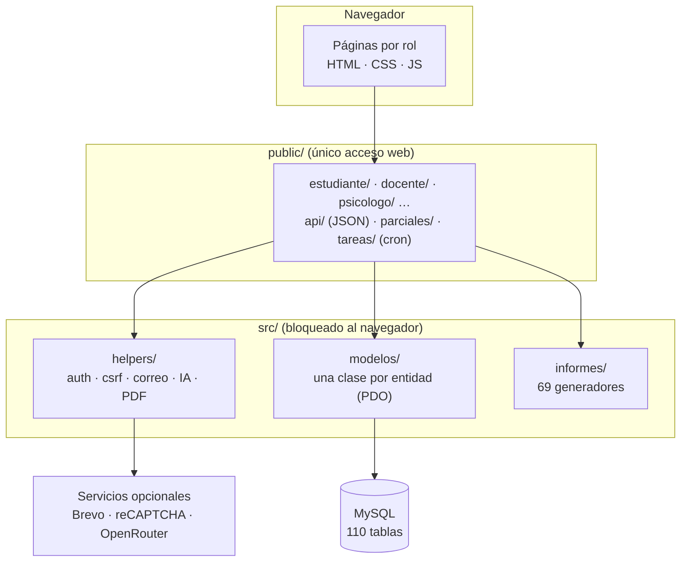

Cada página valida la sesión y el rol, llama a los modelos y pinta la vista. Fue una decisión consciente para un equipo de dos personas sin framework. **Todas** las consultas filtran por el colegio de la sesión.

<details>
<summary><b>Modelo de datos (tablas principales)</b></summary>

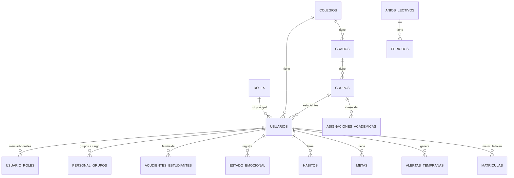

</details>

---

## 🛠️ Tecnología y decisiones

| Capa | Herramientas |
|---|---|
| **Backend** | PHP 8.1+ sin frameworks, PDO |
| **Base de datos** | MySQL 8 / MariaDB |
| **Frontend** | HTML, CSS y JavaScript sin librerías de interfaz; Chart.js, Leaflet y face-api.js puntuales |
| **APIs del navegador** | Web Audio (sonidos), Web Speech (dictado) |
| **Servicios** | Brevo (correo por HTTPS), reCAPTCHA v2, OpenRouter (IA opcional) |
| **Hosting** | InfinityFree (gratuito) |
| **Herramientas** | Git y GitHub, Playwright (capturas automáticas del manual) |

**Decisiones clave:**
- **Software libre y hosting gratuito:** el costo para el colegio tenía que ser cero. Se descartó Firebase por su costo a gran escala para toda una institución.
- **Sin framework:** el hosting gratuito solo ofrece PHP y MySQL, y así entendemos cada línea.
- **Adaptados al hosting:** como no se puede fijar `public/` como raíz, la raíz redirige y un `.htaccess` blinda lo demás. Los correos van por la API de Brevo porque el puerto SMTP está bloqueado.

---

## 📁 Estructura del repositorio

```
serena/
├── index.php · .htaccess        Entrada del sitio (redirige a public/) y bloqueos
├── public/                      Lo único accesible desde el navegador
│   ├── <rol>/                   Pantallas de cada rol
│   ├── api/                     Endpoints JSON
│   ├── tareas/                  Tareas programadas (cron con secreto)
│   ├── parciales/               Encabezado, menú y pie compartidos
│   └── assets/                  CSS, JavaScript e imágenes (incl. las 125 capturas de la ayuda)
├── src/                         Lógica, fuera del alcance del navegador
│   ├── config/                  .env.example y conexión
│   ├── modelos/ · helpers/ · informes/ · controladores/
│   ├── ayuda/contenido.json     Todo el texto del centro de ayuda
│   └── respaldos/ · uploads/    Datos (vacíos en el repositorio)
├── sql/
│   ├── instalacion_completa.sql Base completa para instalaciones nuevas
│   ├── schema.sql               Esquema original
│   └── migraciones/             Cambios incrementales (ver ORDEN.md)
├── tools/                       crear_maestro.php · capturar_ayuda.py
└── docs/                        Instalación, ayuda, presentación y notas de desarrollo
```

---

## 🚀 Instalación rápida

```bash
# 1. Base de datos: crea «serena» (utf8mb4) e importa sql/instalacion_completa.sql
# 2. Configuración
cp src/config/.env.example src/config/.env      # completa DB_* (y APP_URL en producción)
# 3. Primera cuenta
php tools/crear_maestro.php tu@correo.com "Tu Nombre" "Clave#Segura1"
# 4. Abre http://localhost/serena/ y entra como Superadministrador
```

📘 Guía completa (Laragon, XAMPP, InfinityFree, tareas programadas, verificación en 2 pasos y actualización): **[docs/INSTALACION.md](docs/INSTALACION.md)**

---

## 🎬 Modo demostración

La cuenta maestra crea en un clic un **colegio ficticio** con 24 estudiantes, notas, asistencia, horarios, alertas y registros de bienestar. Desde ahí puede **entrar con cualquiera de los 11 roles** y seguir un guion de presentación. Se restablece cuando quieras y nunca toca los datos reales.

---

## 📚 Documentación

| Documento | Contenido |
|---|---|
| [`docs/INSTALACION.md`](docs/INSTALACION.md) | Instalación, variables, tareas programadas, 2FA y actualización. |
| [`sql/migraciones/ORDEN.md`](sql/migraciones/ORDEN.md) | Cómo aplicar las migraciones en una instalación existente. |
| [`docs/AYUDA.md`](docs/AYUDA.md) | Cómo editar el centro de ayuda por rol. |
| [`docs/GUIA_CAPTURAS.md`](docs/GUIA_CAPTURAS.md) | Regenerar automáticamente las capturas del manual. |
| [`docs/Presentacion_Serena_SENA_final.pptx`](docs/Presentacion_Serena_SENA_final.pptx) | Presentación de la socialización de etapa productiva. |
| [`docs/notas-de-desarrollo/`](docs/notas-de-desarrollo/) | Notas de cada fase y registro de cambios. |

---

## 🧭 Hoja de ruta

- [ ] **Pruebas automáticas** (PHPUnit y navegador), para no depender solo de las pruebas manuales.
- [ ] **Cifrado del diario** con una clave derivada del PIN del estudiante.
- [ ] **Notificaciones push** y app instalable, para que las alertas lleguen más rápido.
- [ ] **Migraciones automáticas** al desplegar.
- [ ] **Pruebas de usabilidad** con estudiantes, docentes y personas con discapacidad.

---

## 🤝 Equipo

Proyecto de etapa productiva del **Técnico en Desarrollo de Software (SENA)**, desarrollado en la **I.E. INEM José Félix de Restrepo**, Medellín.

| | Aprendiz | Rol en el proyecto |
|:---:|---|---|
| 👨‍💻 | **David Santiago Mosquera Mosquera** · [@dasanmos](https://github.com/dasanmos) | Desarrollador full stack · Product Owner · Analista de requerimientos |
| 🎨 | **Ana Sofía Ángel Moncada** | Gestora de proyectos · Diseñadora UI/UX (identidad visual y logo) |

¿Quieres usar Serena en tu institución o colaborar? Abre un *issue* en este repositorio.

---

<div align="center">

**Serena** · bienestar emocional y gestión académica al alcance de toda la institución

<sub>SENA · Técnico en Desarrollo de Software · 2026</sub>

</div>
